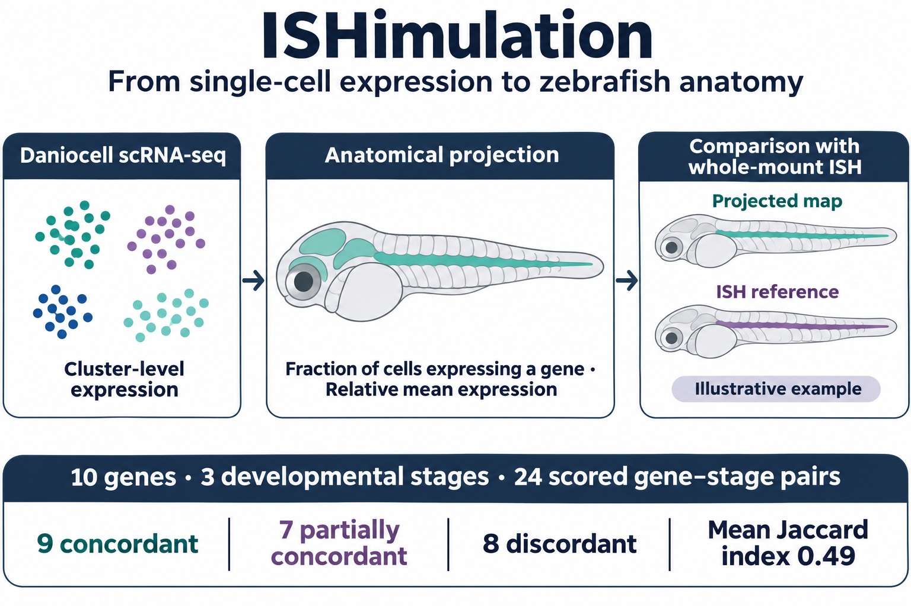

# ISHimulation

**Mapping zebrafish single-cell gene expression to embryonic anatomy**

ISHimulation is an interactive web tool that turns single-cell RNA-seq data into simulated, ISH-style expression maps on a schematic zebrafish embryo. It then checks those maps against real whole-mount in situ hybridization (ISH) data.

**[Open the live tool →](https://anilkchalla.github.io/ISHimulation/)** · [GitHub repository](https://github.com/anilkchalla/ISHimulation)

> **For research and hypothesis generation only.** The maps are simulations built from cluster-level averages, not images of real embryos. Always confirm a pattern against the original ISH before you rely on it.

---

## Abstract

Single-cell RNA sequencing identifies which zebrafish cell populations express a gene, but tissue dissociation removes information about where those cells were located in the embryo. ISHimulation is a proposed research and teaching resource that includes an interactive web tool for projecting Daniocell cluster-level expression data onto predefined regions of a schematic zebrafish embryo. The tool visualizes two measures of expression for each region: the fraction of cells with detectable transcripts and relative mean expression.

In a proof-of-concept evaluation, expression maps for 10 genes across segmentation, pharyngula, and hatching stages were compared with observed whole-mount in situ hybridization (ISH) patterns from the Thisse collection curated in ZFIN. Of 24 scored gene–stage pairs, 9 were concordant, 7 partially concordant, and 8 discordant. The mean Jaccard index was 0.49. The maps captured tissue-level patterns such as pronephric *cdh17* and notochordal *tbxta* expression. Discrepancies for *pax2a* and *egr2b* illustrated the difficulty of resolving discrete neural domains from broad tissue clusters. Limited transcript detection may have contributed to discrepancies for *crx* and early *egr2b*, while ambient RNA may have contributed to unexpected *krt4* signal.

ISHimulation provides a way to compare single-cell expression summaries with observed embryonic expression patterns, identify discrepancies for follow-up, and demonstrate how cluster resolution and transcript detection shape the anatomical patterns that can be recovered.

---

## Who it's for

| If you are… | ISHimulation helps you… |
|---|---|
| **A researcher** | Get a quick anatomical view of a gene before ordering probes, flag expression domains worth following up, and sanity-check scRNA-seq cluster annotations against ISH |
| **An instructor** | Show students what single-cell data can and cannot reveal about where genes are expressed, using real data and a clear scoring system |
| **A student** | Explore how the size of a cluster, detection sensitivity and background RNA change the picture you get from sequencing |

## How to use the tool

1. **Pick a gene** from the list at the top of the page.
2. **Pick a stage:** Segmentation, Pharyngula or Hatching.
3. **Choose a view:**
   - **Predicted:** teal shading from Daniocell. Darker means a larger share of cells and higher expression.
   - **Observed:** purple hatched outlines where Thisse ISH detected the gene.
   - **Overlay:** both at once, so you can see where they agree and disagree.
4. **Point at any region** of the embryo to see which Daniocell cell groups and which ISH annotations sit behind it.
5. **Read the side panel** for the agreement score, the cell group-to-region table, and links to the gene's pages in Daniocell, ZFIN and Zebrahub gene2fish.
6. **Scroll down** to see the full agreement grid for all genes and stages, a breakdown of why predictions miss, and recommended next steps.

## Proof-of-concept results

**Stages compared**

| Stage | Daniocell (scRNA-seq) | Thisse ISH |
|---|---|---|
| Segmentation | 14–21 hpf | 14–19 somites |
| Pharyngula | 24–34 hpf | 20–25 somites to Prim-25 |
| Hatching | 48–58 hpf | High-pec to Long-pec |

**Agreement by gene** (✅ concordant · 🟨 partial · ❌ discordant · – no ISH annotation at that stage)

| Gene | Main tissue | Segmentation | Pharyngula | Hatching |
|---|---|:-:|:-:|:-:|
| *cdh17* | Pronephros | ✅ | ✅ | ✅ |
| *gata1a* | Blood | ✅ | ✅ | – |
| *mpx* | Myeloid cells | – | ✅ | ✅ |
| *tbxta* | Notochord, tail bud | ✅ | ✅ | – |
| *her1* | Presomitic mesoderm | 🟨 | ❌ | – |
| *krt4* | Skin | 🟨 | 🟨 | 🟨 |
| *pax2a* | Pronephros, otic, brain | ❌ | 🟨 | 🟨 |
| *crx* | Eye, epiphysis | ❌ | ❌ | 🟨 |
| *egr2b* | Hindbrain | ❌ | ❌ | ❌ |
| *fabp10a* | Liver | – | – | ❌ |

### Where the simulation agrees with ISH

The 9 concordant gene–stage pairs come from four genes with expression confined to a single, well-resolved tissue. Daniocell values are shown as *% of cells expressing · relative mean expression*. ZFIN figure links open the original Thisse ISH images; these are copyrighted by their authors and displayed by ZFIN with permission, so they are linked rather than reproduced here.

| Gene | Stage | Daniocell (scRNA-seq) | Thisse ISH (ZFIN term) | ISH figures |
|---|---|---|---|---|
| *cdh17* | Segmentation (14-21 hpf) | pronephros 88% · 0.81 | pronephric duct | [14-19 somites](https://zfin.org/ZDB-FIG-050630-9854) |
|  | Pharyngula (24-34 hpf) | pronephros 87% · 1.00 | pronephric duct | [20-25 somites to Prim-5](https://zfin.org/ZDB-FIG-050630-1895) · [Prim-15 to Prim-25](https://zfin.org/ZDB-FIG-050630-10214) |
|  | Hatching (48-58 hpf) | pronephros 84% · 0.98 | pronephric duct | [High-pec to Long-pec](https://zfin.org/ZDB-FIG-050630-3271) |
| *gata1a* | Segmentation (14-21 hpf) | erythrocytes 59% · 1.00 | ventral mesoderm | [14-19 somites](https://zfin.org/ZDB-FIG-060130-310) |
|  | Pharyngula (24-34 hpf) | erythrocytes 81% · 0.80 | blood, intermediate cell mass of mesoderm | [20-25 somites to Prim-5](https://zfin.org/ZDB-FIG-060130-311) · [Prim-15 to Prim-25](https://zfin.org/ZDB-FIG-060130-148) |
| *mpx* | Pharyngula (24-34 hpf) | immune cells 24% · 0.84 | macrophage | [20-25 somites to Prim-5](https://zfin.org/ZDB-FIG-050630-6642) · [Prim-15 to Prim-25](https://zfin.org/ZDB-FIG-050630-14026) |
|  | Hatching (48-58 hpf) | immune cells 32% · 1.00 | macrophage | [High-pec to Long-pec](https://zfin.org/ZDB-FIG-050630-7110) |
| *tbxta* | Segmentation (14-21 hpf) | notochord 94% · 0.94; paraxial mesoderm (tail bud) 95% · 0.79 | notochord, tail bud | [14-19 somites](https://zfin.org/ZDB-FIG-050630-6935) |
|  | Pharyngula (24-34 hpf) | notochord 94% · 0.88 | notochord | [20-25 somites to Prim-5](https://zfin.org/ZDB-FIG-050630-14844) · [Prim-15 to Prim-25](https://zfin.org/ZDB-FIG-050630-131) |

**In brief:**

- ***cdh17***: Pronephros-specific at every stage; the cleanest match.
- ***gata1a***: Erythroid lineage only; Thisse marks ventral mesoderm, then ICM and blood.
- ***mpx***: Only in immune cells, in a subset (24–32%) consistent with a single myeloid subtype (neutrophils).
- ***tbxta***: Notochord at every stage, plus tail-bud progenitors during segmentation.

The other three stages of these genes (*gata1a* and *tbxta* at hatching, *mpx* at segmentation) had no Thisse ISH annotation and were not scored. Daniocell still detects *tbxta* in 74% of notochord cells at 48–58 hpf, a prediction that could be checked by ISH.

**What the results tell us**

- **Single-tissue genes work well.** When a gene is confined to one tissue that Daniocell captures as its own cluster, the simulation matches the ISH.
- **Fine brain domains get blurred.** Patterns like the midbrain–hindbrain boundary or individual rhombomeres are averaged into one large "neural" cluster. Mapping Daniocell's finer sub-clusters should recover much of this.
- **Some genes are simply under-detected.** Low-abundance transcripts can be missed in dissociated cells. No mapping method can recover molecules that were never captured.
- **Background RNA adds false signal.** *krt4* appears at low levels in almost every cluster.

## How it works

1. **Single-cell input.** For each gene, the fraction of cells expressing it and its relative mean expression are read from Daniocell's per-gene dot plots ([Sur et al., 2023](https://daniocell.nichd.nih.gov/)).
2. **Anatomical projection.** Each Daniocell tissue cluster is assigned to a region of the schematic embryo. A region is "called" when at least 20% of its cells express the gene with at least 0.4 relative expression. Weaker signal is shown faintly but not scored.
3. **ISH reference.** Observed patterns come from ZFIN's wild-type expression annotations for the Thisse high-throughput ISH screens. ZFIN anatomy terms are mapped to the same regions.
4. **Scoring.** Agreement is the Jaccard index of predicted and observed regions: the regions both sources share, divided by all regions either one names. Scores are classed as Concordant (≥ 0.67), Partial (0.25–0.66) or Discordant (< 0.25).

The full cluster-to-region and term-to-region tables are listed at the bottom of the tool page.

## Limitations

- The embryo is a **schematic**, not to scale, and one body plan is reused for all three stages.
- Relative expression is **estimated from dot colour** on Daniocell's plots, not from raw counts.
- "No ISH annotation" means the Thisse screen recorded nothing at that stage. That is **not proof the gene is absent.**
- Known sources of error include ambient RNA, cell loss during dissociation, transcript dropout and incomplete ISH annotation.

## Run it yourself

The tool is a single self-contained HTML page with no server or external libraries.

- **View locally:** download the repository and open `index.html` in any modern browser.
- **Host your own copy on GitHub Pages:** go to Settings → Pages, choose *Deploy from a branch*, then select `main` and `/ (root)`.

### Add genes or stages

| File | Purpose |
|---|---|
| `data.json` | Daniocell values, ZFIN ISH terms, Thisse figure IDs and gene notes for each gene and stage |
| `logic.js` | Region definitions, mapping tables, calling thresholds and scoring |
| `template.html` | Page layout and interactivity |
| `build.py` | Combines the three files above into `index.html` (`python3 build.py`) |
| `score.js` | Prints the agreement grid in a terminal (`node score.js`) |

To add a gene, add its Daniocell values and ZFIN terms to `data.json`, map any new ZFIN terms in `logic.js`, and run `python3 build.py`.

## Data sources

- **Daniocell:** Sur A, et al. (2023). Single-cell analysis of shared signatures and transcriptional diversity during zebrafish development. *Developmental Cell*. [daniocell.nichd.nih.gov](https://daniocell.nichd.nih.gov/)
- **ZFIN:** Zebrafish Information Network, wild-type expression data (release 19 Nov 2026). [zfin.org/downloads](https://zfin.org/downloads)
- **Thisse ISH collection:** Thisse B, Thisse C, et al. High-throughput expression analysis (2001–2008), via ZFIN. The images can also be browsed in [Zebrahub gene2fish](https://zebrahub.sf.czbiohub.org/gene2fish).

All data belong to their original providers and remain under their own terms. Please cite them when using results from this tool.

## License

ISHimulation is licensed under the [Creative Commons Attribution-NonCommercial-ShareAlike 4.0 International License](https://creativecommons.org/licenses/by-nc-sa/4.0/). You may share and adapt it for **non-commercial** purposes, as long as you **give credit** and release any adaptations under the **same license**. See [`LICENSE`](LICENSE) for details.

This license covers the tool's code, text and graphics. It does not cover the Daniocell, ZFIN or Thisse data, which remain under their providers' terms.

## How to cite

> Challa AK. *ISHimulation: Mapping zebrafish single-cell gene expression to embryonic anatomy.* 2026. https://github.com/anilkchalla/ISHimulation

## Author

**Anil K. Challa, Ph.D.** · [anilkchalla.github.io](https://anilkchalla.github.io) · akchalla@uab.edu

Feedback, suggested genes and collaboration ideas are welcome.
